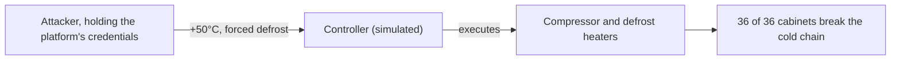
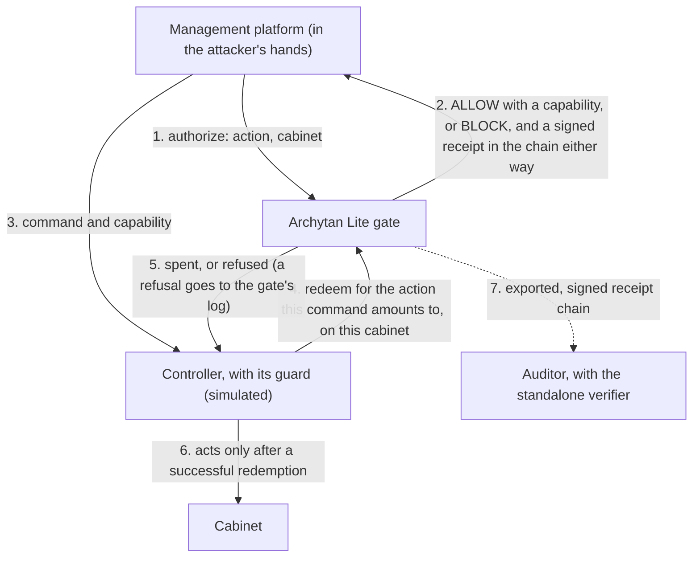

# Cold-chain: a compromised management platform against an execution boundary

On the night of 11 to 12 October 2026, attackers remotely defrosted
refrigerated cabinets at several French supermarket chains, by press
reports in 250 to 350 stores
([BleepingComputer](https://www.bleepingcomputer.com/news/security/cyberattack-shuts-down-refrigerators-at-french-supermarkets/)).
How they got in hasn't been published.

This experiment asks one question about that kind of attack: when someone
takes over the platform that manages refrigeration controllers, does that
platform's authority over the controllers become theirs? It runs the same
attack twice against a simulated estate of 12 stores and 36 cabinets, once
with the controllers trusting the management platform and once with
Archytan Lite in the command path. The gate is the published, signed
Archytan Lite release image, so anyone can rerun it, inspect the policy and
verify the evidence.

## Run it

Needs Docker (Docker Desktop on Windows and macOS) and Python 3.10 or later.

```powershell
.\run-demo.ps1              # Windows
.\run-demo.ps1 --revoke     # adds part 2e: the operator revokes the platform's role mid-incident
.\run-demo.ps1 --pause      # waits for Enter between parts
```

```sh
./run-demo.sh               # macOS and Linux; the same flags
```

The first run creates `.venv` with the official `archytan-lite` client from
PyPI (`requirements.txt`), pulls the gate image, and runs `setup_gate.py`:
the gate's signing key is generated by the image's own `keygen` inside a
Docker volume it never leaves, and the three credentials by its `callergen`.

A standard run takes about 15 seconds and always ends with the same
numbers: 36 of 36 cabinets lost without the gate, 0 of 36 with it, 146
signed decisions. With `--revoke`, 153. Each run writes to `runs/<time>/`:
the transcript, the gate's and controllers' logs, the decision log
(`lite.db`), the policy the gate ran under, an auditor's export of the signed
log (`evidence/`), `results.json` with every number, and `provenance.json`
with the image digest and the hash of every script and configuration file
the run used.

To check every outcome against `expected.json`, including the standalone
verifier (which needs Go), run `validate.py` with the Python in `.venv`:

```powershell
.venv\Scripts\python validate.py   # Windows
```

```sh
.venv/bin/python validate.py       # macOS and Linux
```

## Verify the image first

The gate image is signed by Archytan Lite's release workflow. To check the
one this experiment pins (`ghcr.io/high-archytech-solutions/archytan-lite:2.5.0`):

```sh
docker run --rm -e COSIGN_REPOSITORY=ghcr.io/high-archytech-solutions/archytan-lite-signatures \
  ghcr.io/sigstore/cosign/cosign:v2.4.1 verify \
  ghcr.io/high-archytech-solutions/archytan-lite:2.5.0 \
  --certificate-identity-regexp '^https://github.com/High-ArchyTech-Solutions/archytan-lite/\.github/workflows/release\.yml@refs/tags/v' \
  --certificate-oidc-issuer https://token.actions.githubusercontent.com
```

In PowerShell, end each line with a backtick instead of a backslash. In Git
Bash on Windows, set `MSYS_NO_PATHCONV=1` first, or the identity pattern
gets rewritten as a path.

## What happens

**Part 1.** In the unguarded baseline, the simulated controllers execute any
command carrying the management platform's API key. The attacker holds that
key and the platform's gate credential, sets every cabinet to +50°C and
forces a defrost on each. After three simulated hours all 36 cabinets have
broken the cold chain.

**Part 2.** Same attacker, same credentials. Each controller now acts only
on a single-use capability from the gate, and spends it for the exact
command it's about to run before anything moves. Routine work still goes
through: the platform sets a freezer to -22°C, and an engineer with their
own credential takes another to -26°C, outside the approved band. The
attack fails four ways:

| Attempt | Outcome |
|---|---|
| a. +50°C straight to the controllers | refused by every controller: no capability |
| b. ask the gate for +50°C, or to stop a compressor | BLOCK: those need the engineer's role |
| c. get a harmless in-band change approved, send +50°C with it | ALLOW at the gate, then refused at redemption: the controller spends the capability for the class of command it's about to run (out of band), and the capability was issued for an in-band change |
| d. forced defrost on every cabinet | 3 ALLOW, 33 BLOCK: the remote platform may start 3 defrosts an hour |

After three simulated hours no cabinet has left its limits.

Attempts a and c carry the design. The controller itself demands a
capability and spends it for the command it's about to execute, so the
protected system participates in enforcement. Traffic that reaches a
controller directly carries no authority (a), and a genuine ALLOW for one
class of action is useless for another (c). A capability names a class of
action and one cabinet. It doesn't name a value, so an in-band capability
could set any in-band temperature on that cabinet, which the band allows
anyway.

**Part 2e, with `--revoke`.** Incident response. The attacker collects three
in-band capabilities and holds them. The operator removes `remote_operator`
from the policy and the gate reloads it live with SIGHUP, with no restart.
The held capabilities are refused when the controllers try to spend them,
because Archytan Lite re-checks every grant against the policy in force at
redemption; new requests from the platform are blocked; the engineer's
routine change still goes through. The receipts show which policy each
decision was made under: 149 under the original, 4 under the revoked one.

**Part 3.** The gate's log is verified (`--verify-chain`) and exported for
an auditor; the refusal of +50°C on one cabinet is printed as the gate
signed it and checked with the official client.

## Where the trust moved

The experiment assumes the management plane is already lost. What it
relies on instead sits next to the cabinets.

**The classifier is the trust boundary.** Archytan Lite doesn't decide whether +50°C
is unsafe. `coldchain.py`, on the controller side, maps each command to a
class of action using the cabinet's approved band
(`refrigeration.setpoint.in_band`, `refrigeration.setpoint.out_of_band`,
`refrigeration.defrost.start`, and so on), and Archytan Lite decides which
credentials may perform each class. In production the question becomes
where that classification lives and who can change it. Here it lives with
the controller's guard, and changing the band table should itself be a
protected change.

| Assumed compromised | Still trusted | Not covered by this pattern |
|---|---|---|
| The management platform | The gate's signing key | Code execution on a controller |
| The platform's gate credential | The gate host and its database | Physical access to the equipment |
| The controllers' API key | The policy, and whoever can change it | A second path to the equipment that skips the guard |
| The network path to the management layer | The classifier and its band table | Compromise of the signing key or the gate host |
| | The controller-side guard and its credential | Anyone holding the engineer credential |
| | Custody of the engineer credential | A patient attacker working within the defrost ceiling |

With everything in the first column, the attacker can still make any
in-band change and start 3 remote defrosts an hour. `docs/threat-model.png`
is the same table as a one-page graphic.

## How it's wired

In the unguarded baseline (part 1) a simulated controller executes any
command carrying the platform's API key, so whoever holds the platform's
credentials holds the controllers' authority:



In part 2 the API key alone moves nothing. The platform has to get a
capability from the gate, and the controller spends it for the command it's
about to run before it acts:



The gate runs as a container. Everything it reads or writes lives in Docker
volumes and moves in and out with `docker cp`: the run's decision log is
copied to `runs/<time>/lite.db` when the gate stops, and the run's volume is
removed. `--verify-chain` and `--export-chain` run from the same image.

## Checking a run independently

Every run writes an auditor's export to `runs/<time>/evidence/`:
- `manifest.json` and `manifest.sig`: what the export holds, signed with the gate's Ed25519 key.
- `receipts.json`: every decision, each signed and hash-chained to the one before.
- `verifier/`: a standalone checker that uses only Go's standard library.

```sh
cd runs/<time>/evidence/verifier
go run . --export .. --trusted-keys "$(cat ../../../../gate/public_key.hex)"
```

It prints something like this:

```
manifest OK: signed by trusted key 3629878f…
  exported 2026-10-14T14:49:31Z from urn:archytan-lite:instance:coldchain-demo
  declared mode: enforce; declared caller identity: bound
  policy file SHA-256 at export: 60f74a5f…
receipts OK: receipts.json is the file the manifest describes
chain OK: 146 receipt(s) verified, unbroken from genesis; count and chain tip match the manifest
  decisions: ALLOW 41, BLOCK 105
  receipt versions: v1 0, v2 146
  decided under policy 60f74a5f…: ALLOW 41, BLOCK 105
checkpoints: none in this export
```

## What this shows, and what it doesn't

- **The controllers are simulated.** They model no vendor's product, and
  Archytan Lite has no integration with any refrigeration hardware today.
  The gate, its policy, the capabilities and the signed receipts are the
  real product.
- **It doesn't claim this would have stopped the French incident.** The
  root cause isn't public. The experiment shows an architectural pattern: a
  compromised management plane doesn't automatically hold the authority to
  issue dangerous physical commands.
- **The band check is controller-side code.** Archytan Lite's policy names
  roles per action and doesn't compare numbers. `coldchain.py` classifies a
  setpoint as in or out of band, on the controller side, from the command
  it's about to execute; the policy decides who may do each class.
- **The controller has to refuse to act without a capability.** That
  check runs on the controller or right next to it, outside the management
  platform. A path that changes equipment without spending a capability is
  as unguarded as before.
- **A compromised controller isn't covered.** The attacker here holds the
  management platform. An attacker who can run code on a controller, or
  reach the equipment by a path that skips the check, never asks the gate.
  The article above cites published authentication-bypass and
  command-injection flaws in refrigeration system managers, which is that
  kind of access. This pattern answers a takeover of the management plane;
  the controllers themselves still need patching and keeping off the
  internet.
- **The defrost ceiling bounds a burst, and a patient attacker can work
  inside it.** It stopped 33 of 36 defrosts in the burst. An attacker who
  spends the 3 an hour on the same cabinet keeps it almost continuously in
  defrost, which would break its cold chain. A minimum interval between
  remote defrosts on one cabinet, enforced by the controller, would close
  that; the experiment doesn't have one.
- **The defrost ceiling lives in memory.** It counts wall-clock time and
  resets when the gate restarts, so it limits blast radius and the receipt
  chain is the cryptographic part. A production deployment that relies on
  it would want a ceiling that survives restarts, or one coordinated
  outside the gate.
- **The engineer credential has to live somewhere else.** The out-of-band
  path is only as strong as its custody. If the management platform also
  stores engineer credentials, it falls with the platform. In production it
  belongs on a separate device or with the retailer. Two-person approval is
  reserved in Archytan Lite's decision vocabulary (HOLD, ESCALATE) and not wired.
- **The gate has to sit outside the service provider's control.** If the
  provider runs the gate and holds its key and policy, a provider compromise
  reaches those too. The arrangement assumed here: the retailer's OT team
  holds the policy and keys, and the provider holds only the remote
  operator role.
- **When the gate is unreachable, remote changes stop.** That's what
  fail-closed means here. Only remote commands need a capability, so in
  this design the controllers' local control loops and scheduled defrosts
  keep running.
- **The temperatures are demo settings.** The thermal model is a simple
  simulation for showing outcomes. The bands, breach limits and rates are
  plausible values that nobody measured.
- **The gate's per-address rate limit is raised**, because every simulated
  store calls from the same loopback address.

## Files

| File | What it is |
|---|---|
| `gate/policy.json` | Who may do each class of command, and the defrost ceiling. |
| `coldchain.py` | The estate (12 stores, 36 cabinets), the approved bands, and how a command maps to a gated action. |
| `controller.py` | The simulated controllers, in `open` or `guarded` mode. |
| `demo.py` | Runs the three parts and writes the transcript and `results.json`. |
| `gates.py` | Runs the gate from the published image. |
| `setup_gate.py` | Creates the gate's signing key and the credentials (first run only). |
| `validate.py`, `expected.json` | Runs both scenarios and checks every outcome. |
| `requirements.txt` | The pinned Python client. |
| `docs/threat-model.png` | The threat model as a one-page graphic. |
| `secrets/` | Created by setup: the demo's credentials. Don't share them. |
